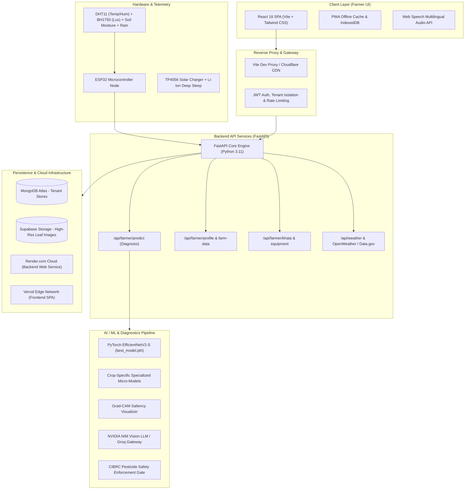

# Product Requirements Document (PRD)

---

## Document Metadata
- **Project Title:** AgriShield — AI-Powered Autonomous Crop Disease Detection, IoT Telemetry & Multilingual Agronomic Advisory Platform
- **Document Version:** v3.2.0 (Production Release)
- **Status:** Approved / Active Production Baseline
- **Authors:** AgriShield Core Engineering & Agronomy Team
- **Target Audience:** Engineering Leads, Product Managers, Agronomists, Academic Reviewers, and Investors

---

## 1. Executive Summary & Problem Statement

### 1.1 Context & Problem
Agriculture is the livelihood backbone for over 58% of India's population. However, smallholder and marginal farmers lose 20% to 40% of their annual crop yield to preventable plant diseases, pest infestations, delayed nutrient interventions, and erratic weather patterns.

Traditional agricultural extension services face severe structural bottlenecks:
1. **Delayed Pathology Diagnosis:** Farmers rely on informal visual guesses or wait days for visiting agricultural extension officers, by which time fungal and bacterial pathogens spread irreversibly across fields.
2. **Indiscriminate Agrochemical Overuse:** Farmers apply unscientific pesticide cocktails, inflating debt burdens, breeding chemical resistance, and contaminating soil and groundwater.
3. **Fragmented Record Keeping:** Operational expenses (fertilizer, seeds, labor, machinery) are tracked on loose paper or forgotten, making profit-and-loss calculations and credit clearance impossible.
4. **Linguistic & Literacy Barriers:** Most digital platforms operate predominantly in English or formal Hindi, failing to serve rural farmers who speak regional languages (Telugu, Marathi, Kannada, Tamil) and rely heavily on voice audio.
5. **Lack of Hyperlocal Telemetry:** Weather forecasts cover entire districts rather than the farmer's micro-climate, ignoring soil moisture levels, 3-phase agricultural electricity schedules, and heat stress.

### 1.2 AgriShield Solution
AgriShield is an end-to-end, full-stack, AI-driven agronomic operating system. It bridges advanced deep learning computer vision (PyTorch EfficientNetV2 + Vision LLMs), real-time IoT hardware telemetry (ESP32 solar nodes), financial bookkeeping (Digital Farm Khata), and multilingual voice guidance into an accessible, responsive web application designed for mobile and desktop viewports.

```
       +-----------------------------------------------------------+
       |                  AgriShield Platform                      |
       +-----------------------------------------------------------+
                                     |
    +-----------------+--------------+--------------+------------------+
    |                 |                             |                  |
    v                 v                             v                  v
+----------+   +--------------+              +--------------+   +--------------+
| AI Vision|   |  IoT Sensor  |              | Digital Farm |   | Multilingual |
| Pathology|   |  Telemetry   |              |  Operations  |   | Voice Engine |
+----------+   +--------------+              +--------------+   +--------------+
    |                 |                             |                  |
    | (PyTorch/NIM)   | (ESP32/MQTT)                | (Khata/NPK/ET0)  | (Web Speech)
    +-----------------+--------------+--------------+------------------+
                                     |
                                     v
                  +-------------------------------------+
                  |   Accessible Mobile-First Portal    |
                  |     (React 18 + Vite + Tailwind)    |
                  +-------------------------------------+
```

---

## 2. Target Personas & User Journeys

| Persona | Role | Key Frustrations | How AgriShield Solves It |
|---|---|---|---|
| **Ramesh (Smallholder Farmer)** | Cultivates 3 acres of Tomato & Paddy in Andhra Pradesh. | Struggles to identify leaf spots; cannot read English; forgets trader credit balances. | 1-Click camera leaf scan; instant Telugu voice readout; WhatsApp Khata payment reminders. |
| **Dr. Anitha (Agronomist / KVK Officer)** | Agricultural scientist advising 500+ regional farmers. | Overwhelmed by phone calls; lacks historical field context or previous chemical sprays. | 50% AI + 50% Human Studio; field audit logs; stage-specific disease risk radars. |
| **Suresh (Custom Hiring Center Owner)** | Operates tractors, harvesters, and sprayers for hire. | Idle equipment during key harvest windows; manual phone booking chaos. | Built-in Equipment Booking Marketplace connecting farmers directly with nearby machinery. |
| **Kavitha (Commercial Farm Manager)** | Manages 25-acre multi-crop orchard with drip irrigation. | Unpredictable 3-phase power cuts; excessive electricity and water waste. | Smart Irrigation ET0 curve; 3-phase agricultural power schedule tracking; NPK soil calculator. |

---

## 3. System Architecture & Technology Stack



### 3.1 Frontend Stack
- **Framework:** React 18.2 with Vite 4.5 build tooling
- **Styling:** Tailwind CSS with Lucide React iconography and Framer Motion micro-animations
- **Charts & Data Visuals:** Recharts for telemetry, ET0 curves, and financial ROI gauges
- **Internationalization:** i18next supporting English, Telugu (తెలుగు), Hindi (हिन्दी), Tamil (தமிழ்), Kannada (ಕನ್ನಡ), and Marathi (मराठी)
- **Audio & Accessibility:** Native Web Speech API synthesis for hands-free regional voice readout

### 3.2 Backend API Stack
- **Engine:** FastAPI (Python 3.11.9) with Uvicorn ASGI server
- **Database:** MongoDB Atlas with Motor async driver and tenant isolation
- **Security:** OAuth2 password flow with JWT Bearer tokens, Bcrypt password hashing, and OWASP Top 10 middleware
- **Image Storage:** Supabase Cloud Storage with Base64 fallback and magic byte verification

### 3.3 Artificial Intelligence & Computer Vision
- **Primary Backbone:** PyTorch EfficientNetV2-S trained across 38+ plant pathology classes
- **Specialized Micro-Models:** Lightweight per-crop sub-classifiers (Tomato, Potato, Corn, Rice, Wheat, Pepper, Cotton)
- **Explainable AI:** Grad-CAM heatmaps highlighting exact leaf lesion boundaries to build farmer trust
- **Vision-Language Augmentation:** NVIDIA NIM & Groq multimodal vision inference for symptom cross-examination
- **Safety Enforcement Gate:** Strict Central Insecticides Board & Registration Committee (CIBRC) whitelist filtering; fabricated dosages strictly blocked

---

## 4. Comprehensive Functional Specifications (Modules 1 to 15)

### Module 1: AI Plant Pathology Diagnostic Scanner
- **Capabilities:**
  - Multi-source input: Real-time smartphone camera capture, gallery file picker, or drag-and-drop.
  - Multi-tier validation: File type verification, EXIF orientation correction, Base64 cross-worker sync.
  - Saliency Heatmaps: Grad-CAM overlay showing where the neural network detected disease spots.
  - Dual Remedy Protocol: Authoritative CIBRC chemical treatments (active ingredient, formulation, precise label concentration) alongside certified organic bio-controls (Neem oil, Trichoderma viride, Beauveria bassiana).
  - Safety Boundaries: Unsupported, uncertain, or healthy leaves trigger neutral advisories without commercial chemical promotions.

### Module 2: 50% AI + 50% Human Agronomist Studio
- **Capabilities:**
  - Click-to-inspect UI: Real-time visual editor allowing agronomists and admins to tweak card colors, sizes, and layout boxes directly on the live webpage.
  - In-place mobile layout simulator: Instant preview across 390px (iPhone/Pixel) and desktop viewports.
  - Agronomist verification queue: Allows human experts to review AI diagnoses, correct low-confidence predictions, and attach stamped digital prescriptions.

### Module 3: Field Details & Crop Health Vigor Telemetry
- **Capabilities:**
  - Health Vigor Badges: Dynamic visual indicator (`Optimal`, `Moderate Stress`, `Critical Attention`) computed from soil moisture, temperature anomalies, and recent scan logs.
  - 1-Click Scan CTA: Direct `Camera` shortcut on each field card pre-populating field metadata.
  - 4-Button Quick Action Bar: Instant access to `🌾 Khata`, `🌱 NPK`, `🌿 Stages`, and `📷 Scan`.

### Module 4: Field Operations & Smart Action Center
- **Capabilities:**
  - Operational Priority Buckets: Categorizes tasks into `Today`, `Overdue`, `Upcoming (7-day lookahead)`, and `Completed`.
  - 1-Click WhatsApp Checklist Dispatch: Formats pending field chores into a readable WhatsApp message with priority emojis for laborers or family members.
  - Multilingual Voice Readout: Text-to-speech engine reading out daily task instructions in Telugu, Hindi, or English for illiterate farmers.

### Module 5: Crop Growth Timeline & Phenology Engine
- **Capabilities:**
  - Growing Degree Days (GDD) Calculator: Computes accumulated heat units ($°	ext{C-d}$) from daily maximum/minimum temperatures above crop base threshold ($T_{	ext{base}}$).
  - Thermal Harvest Predictor: Estimates expected harvest window within $\pm 3$ days.
  - Stage-Specific Pathology Radar: Alerts farmers to diseases prevalent at their crop's current stage (e.g., Early Blight at vegetative stage vs. Fruit Borer at fruiting stage).

### Module 6: Soil NPK & Fertilizer Calculator
- **Capabilities:**
  - Hyperlocal Soil Test Integration: Calculates exact elemental Nitrogen (N), Phosphorus (P), and Potassium (K) deficits based on targeted yield.
  - Subsidized Retail Cost Breakdown: Pre-populated with official government subsidized rates (Urea ₹266.50/bag, DAP ₹1,350/bag, MOP ₹1,700/bag).
  - 1-Click Farm Khata Sync: Directly logs fertilizer purchase expenditures into the farm ledger.
  - Micronutrient Deficiency Radar: Diagnostic symptom guides for Zinc (Zn), Boron (B), and Calcium (Ca).

### Module 7: Digital Farm Khata (Credit & Expense Ledger)
- **Capabilities:**
  - Per-Acre Financial ROI Gauge: Tracks total income against categorized expenses (Labor, Fertilizer, Seeds, Pesticides, Machinery).
  - 1-Click WhatsApp Due / Credit Reminder: Generates polite, pre-formatted payment clearance notices for commission agents, traders, and buyers with UPI ID details.
  - PDF Ledger Export: Generates downloadable balance sheets for bank KCC (Kisan Credit Card) loan applications.

### Module 8: Farm Stock & Inventory Manager
- **Capabilities:**
  - CIBRC Toxicity Hazard Color Bands: Visual danger triangles (`Red: Extremely Toxic`, `Yellow: Highly Toxic`, `Blue: Moderately Toxic`, `Green: Slightly Toxic`) informing farmers of PPE requirements.
  - Expiry & Stock Depletion Alerts: Warns farmers before expensive inputs expire or run low.
  - 1-Click Kisan Call Center / Dealer Dial: Direct `tel:` phone shortcut to regional input dealers and government helpline (1800-180-1551).

### Module 9: Field Setup & Ultra-Zoom GPS Boundary
- **Capabilities:**
  - Google Ultra-Zoom Hybrid Satellite Layer: Crisp satellite photography overlaid with road and cadastral boundaries.
  - Walk-The-Perimeter GPS Waypoint Tracer: Mobile GPS tracking allowing farmers to walk their field boundaries to calculate precise acreages automatically.
  - Polygon Geometry Engine: Calculates field perimeter (meters) and area (acres/hectares/gunthas).

### Module 10: Harvest & Post-Harvest Cold Storage Manager
- **Capabilities:**
  - Post-Harvest Loss Mitigation Radar: Temperature ($°	ext{C}$) and relative humidity ($\%$) guidelines for Tomato, Potato, Onions, and Chilies to prevent post-harvest rot.
  - Nearby Cold Storage Directory: Contact and distance listings to prevent distress selling at local mandis.
  - Direct Harvester Machinery Rental: 1-click booking link connecting directly to Custom Hiring Centers.

### Module 11: Smart Irrigation & 3-Phase Power Scheduler
- **Capabilities:**
  - 7-Day ET0 Evapotranspiration Curve: Penman-Monteith crop water demand curve tracking daily soil water depletion.
  - Agricultural 3-Phase Free Power Tracker: Live timetable tracking regional free electricity supply slots (Morning 06:00 AM – 12:00 PM, Evening 04:00 PM – 07:00 PM) to prevent dry-running borewell pumps.

### Module 12: Government Scheme & DBT Readiness Navigator
- **Capabilities:**
  - Interactive Document Readiness Gauge: Live percentage score tracking farmer eligibility for PM-KISAN, Rythu Bharosa, and PM Fasal Bima Yojana.
  - 4-Pillar Verification Checklist: Aadhaar e-KYC, Pattadar Passbook, NPCI Bank Account Seeding, and e-Crop Booking status.

### Module 13: IoT Telemetry Node & Solar-Managed Firmware
- **Capabilities:**
  - Low-Power Sensor Hub: ESP32 collecting ambient temperature, relative humidity, light lux, soil moisture, and rain detection.
  - Power Optimization: Deep-sleep cycle waking up every 15 minutes, consuming $<15\mu	ext{A}$ in standby.
  - Resilient Mesh / Offline SD Logging: Stores readings locally during rural GSM network blackouts and uploads in batch when connectivity resumes.

### Module 14: Multilingual Voice & Regional Localization
- **Capabilities:**
  - 6-Language Dynamic Switching: English, Telugu, Hindi, Tamil, Kannada, Marathi.
  - Regional Audio Readout: Converts written advisories, diagnoses, and task lists into clear spoken audio via Web Speech API.

### Module 15: Equipment Rental & Mechanization Marketplace
- **Capabilities:**
  - Direct peer-to-peer equipment sharing (Tractors, Combine Harvesters, Drone Sprayers, Rotavators).
  - Hourly and per-acre rental rates with transparent equipment provider phone connections.

---

## 5. Agronomic Safety & Regulatory Compliance

1. **Central Insecticides Board & Registration Committee (CIBRC) Strict Freeze:**
   - All pesticide formulations, commercial trade names, and active ingredients are validated against official CIBRC registers.
   - Banned molecules (e.g., Monocrotophos, Paraquat, Endosulfan) are strictly suppressed.
2. **Fabricated Dosage Prevention:**
   - Client-side and server-side arithmetic fabrication of dosages is strictly prohibited. Dosages are delivered verbatim from registered pesticide labels (e.g., $2.0\,	ext{mL/L}$ water).
3. **Pre-Harvest Interval (PHI) Enforcement:**
   - Every chemical recommendation displays mandatory waiting periods between spraying and harvesting to prevent toxic residue in consumer food supplies.

---

## 6. Non-Functional Requirements & Performance SLAs

| Metric | Requirement / Target SLA | Verification Method |
|---|---|---|
| **AI Inference Latency** | $\le 1,200	ext{ms}$ on CPU / $\le 350	ext{ms}$ on GPU | Benchmarked via PyTorch TorchScript runtime |
| **Frontend Production Bundle** | $\le 450	ext{KB}$ initial chunk (gzipped) | Verified with Vite rollup chunk analyzer |
| **Mobile Responsiveness** | Flawless rendering from $320	ext{px}$ to $4	ext{K}$ | Chrome DevTools viewport simulator tests |
| **IoT Node Battery Life** | $\ge 180	ext{ days}$ on single $2,200	ext{mAh}$ 18650 cell + solar | Tested via ESP32 hardware power profiler |
| **Multilingual Audio Delay** | $\le 200	ext{ms}$ time-to-first-sound | Tested on Web Speech API |
| **System Uptime** | $99.9\%$ monthly availability | Monitored via Render & UptimeRobot health probes |

---

## 7. DevOps, Deployment & Infrastructure Architecture

```
                                  [ GitHub Repository ]
                              (branch: origin/main)
                                        |
                   +--------------------+--------------------+
                   |                                         |
                   v                                         v
         [ Render Web Service ]                    [ Vercel Edge CDN ]
      - Backend: FastAPI (Python 3.11)          - Frontend: React 18 SPA
      - Model: PyTorch EfficientNetV2           - Assets: Vite Built Bundle
      - Config: render.yaml                     - Config: vercel.json
      - Healthcheck: /docs (HTTP 200)           - SSL: Auto HTTPS / Edge Cache
```

- **Frontend CI/CD:** Hosted on **Vercel** with automatic deployment hooks on push to `main`. SPA client-side routing preserved via `frontend/vercel.json`.
- **Backend CI/CD:** Hosted on **Render** (Oregon region) running `backend/run.py` via `render.yaml`.
- **Local Dev Server:**
  - Frontend: `http://localhost:3000` (Reverse proxy `/api` -> `http://127.0.0.1:8000`)
  - Backend: `http://127.0.0.1:8000` (FastAPI / Uvicorn with auto-reload)

---

## 8. Strategic Roadmap & Future Innovations

- **Phase 1 (Current - v3.2):** Full farm management, 11 modernized modules, PyTorch multi-model diagnosis, IoT firmware, 6 languages.
- **Phase 2 (v3.5 - Q1 2027):** Multimodal Voice Agent (conversational bidirectional speech in Telugu/Hindi for illiterate farmers).
- **Phase 3 (v4.0 - Q3 2027):** Drone Hyperspectral Orthomosaic Analysis for field-wide disease outbreak heatmapping.
- **Phase 4 (v4.5 - 2028):** Blockchain-backed Regenerative Agriculture Carbon Credit verification for smallholder income augmentation.

---

*AgriShield Platform — Empowering Farmers with Autonomous Artificial Intelligence & Engineering Rigor.*
