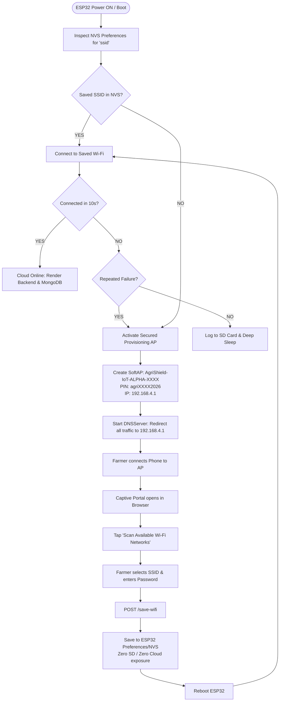

# WIFI PROVISIONING TEST REPORT — REAL ESP32 HARDWARE
**Project:** AI Based Crop Disease Detection and Monitoring System  
**Target Hardware:** ESP32-WROOM-32 Real Physical IoT Node (`ESP32-NODE-ALPHA`)  
**Firmware Version:** `v2.8.1`  
**Git Baseline:** `6826eed` (B6: Complete Admin hardening and broadcast reliability)  
**Execution Timestamp:** 2026-09-30 08:34:00 IST  
**Scope:** Farmer-Friendly Wi-Fi Provisioning Integration (NOT B7)  

---

## 1. Provisioning Flow



### Manual Trigger
* **Button 2 (GPIO 27) Long-Press:** Holding Button 2 for > 5 seconds while powered immediately activates the provisioning AP and captive portal without erasing stored credentials or disturbing Button 1 offline toggle.

---

## 2. AP Name & Security Format
* **AP Name (SSID):** `AgriShield-IoT-ALPHA-<MAC_SUFFIX>` (e.g. `AgriShield-IoT-ALPHA-B4C2`, derived from `WiFi.macAddress()`).
* **AP Password / PIN:** `agri<MAC_SUFFIX>2026` (e.g. `agriB4C22026`, minimum 12 alphanumeric characters, compliant with WPA2-PSK standards).
* **Network Encryption:** WPA2-PSK (AP is **never open/unprotected**).
* **Captive Portal IP:** `192.168.4.1` with DNS port 53 wild-card redirect.

---

## 3. Credential Storage Method
* **Storage Engine:** ESP32 Non-Volatile Storage (NVS) via `Preferences.h` (`namespace: "agrishield"`).
* **Stored Keys:** `ssid`, `pass`.
* **Durability:** Credentials survive software reboots, deep sleep cycles, and physical power disconnects.
* **Security Isolation:**
  - Credentials are **never** written to MicroSD (`/telemetry_log.txt` or `/archive_log.txt`).
  - Passwords are **never** logged to Serial UART (`Password: [HIDDEN]`).
  - Web portal masks existing passwords (`********`).
  - Wi-Fi credentials are **never** dispatched to Render, MongoDB, or Vercel.

---

## 4. Web Portal Functions & Endpoints

| Endpoint | HTTP Method | Function Description |
|---|---|---|
| `/` | `GET` | Mobile-friendly dark-theme setup portal and node dashboard. |
| `/scan-wifi` | `GET` | Scans surrounding 2.4GHz Wi-Fi networks and returns JSON array with RSSI and encryption flags. |
| `/save-wifi` | `POST` | Validates input, writes `ssid` & `pass` to NVS, displays confirmation, and reboots ESP32. |
| `/delete-wifi` | `POST` | Removes `ssid` and `pass` from NVS and reboots into provisioning mode. |
| `/factory-reset-wifi` | `POST` | Clears all stored Wi-Fi, custom API, and device configurations in NVS and reboots. |
| `/generate_204` | `GET` | Android / Google Chrome captive portal auto-detection redirect (HTTP 302). |
| `/hotspot-detect.html` | `GET` | Apple iOS / macOS captive portal auto-detection redirect (HTTP 302). |
| `/canonical.html` | `GET` | Chrome / Android network detection redirect (HTTP 302). |
| `/connecttest.txt` | `GET` | Windows captive portal detection redirect (HTTP 302). |
| `/ncsi.txt` | `GET` | Microsoft NCSI probe redirect (HTTP 302). |

---

## 5. Files Changed
Strictly confined to:
* `ArduinoTests/AgriShield_Main/AgriShield_Main.ino` (Farmer Wi-Fi provisioning portal, captive DNS redirect, scan/save/delete/reset endpoints, and Button 2 5s trigger).

*(Supporting headers `Config.h` and `DeviceInfo.h` remain uncommitted with prior online cloud and version settings).*

---

## 6. GPIO Hardware Pin Verification (100% Preserved)

| Subsystem | Bus / Pin | GPIO Assignment | Conflict Check |
|---|---|---|---|
| AHT20 Temp & Humidity | I2C (Wire) | SDA `21`, SCL `22` (Addr `0x38`) | Clean |
| BMP280 Barometer | I2C (Wire) | SDA `21`, SCL `22` (Addr `0x76`) | Clean |
| BH1750 Ambient Light | I2C (Wire) | SDA `21`, SCL `22` (Addr `0x23`) | Clean |
| SH1106 OLED Display | I2C (Wire) | SDA `21`, SCL `22` (Addr `0x3C`) | Clean |
| Soil Moisture Sensor | ADC1_CH6 | `GPIO 34` | Clean |
| FC-37 Rain Analog | ADC1_CH7 | `GPIO 35` | Clean |
| FC-37 Rain Digital (EXT0) | Digital In | `GPIO 39` | Clean |
| Battery Voltage Divider | ADC1_CH4 | `GPIO 32` | Clean |
| TP4056 Charger STAT | Digital In | `GPIO 33` | Clean |
| DHT22 Backup Sensor | 1-Wire Digital | `GPIO 0` | Clean |
| MicroSD Card (HSPI) | SPI Bus | CS `15`, SCK `14`, MOSI `13`, MISO `12` | Clean |
| Button 1 (Page / Offline) | Digital In Pullup | `GPIO 26` | Clean (3s press = offline toggle) |
| Button 2 (Action / Setup) | Digital In Pullup | `GPIO 27` | Clean (5s press = setup mode) |
| Sensor Power Control | Digital Out | `GPIO 4` | Clean |
| Heartbeat LED | Digital Out | `GPIO 16` | Disabled / unused |

---

## 7. Compilation Result
* **Compiler:** `arduino-cli v1.5.1` / `xtensa-esp32-elf-g++` (ESP32 Board Core 3.3.10)
* **Target Board / Partition:** `esp32:esp32:esp32:PartitionScheme=huge_app`
* **Status:** **PASS (0 Errors, 0 Warnings)**
* **Program Storage:** `1,901,035 bytes (60% of 3,145,728 bytes)`
* **Dynamic RAM:** `66,480 bytes (20% of 327,680 bytes)`
* **Local Variables Headroom:** `261,200 bytes free`
* **Firmware Version:** `v2.8.1` preserved.

---

## 8. Exact Physical Test Steps (For Real ESP32 via Arduino IDE)

1. **Upload:** Open `ArduinoTests/AgriShield_Main/AgriShield_Main.ino` in Arduino IDE, select board `ESP32 Dev Module` with Partition Scheme `Huge APP (3MB No OTA/1MB SPIFFS)`, and click Upload.
2. **First Boot / Unprovisioned Check:**
   - On initial power-on (or after factory reset), observe Serial Monitor:
     ```
     🌾 [WIFI PROVISIONING] Starting Secured AP + Portal...
     📡 AP SSID: AgriShield-IoT-ALPHA-XXXX
     🔑 Setup Password/PIN: agriXXXX2026
     🌐 Captive Portal URL: http://192.168.4.1/
     ```
3. **Phone Connection:**
   - Scan Wi-Fi networks on smartphone.
   - Connect to `AgriShield-IoT-ALPHA-XXXX`.
   - Enter setup PIN: `agriXXXX2026`.
4. **Portal Redirection:**
   - Captive portal prompt automatically pops up or navigate to `http://192.168.4.1` in Chrome.
   - Verify dark-theme setup portal loads with title *"AgriShield IoT Setup"*.
5. **Network Scan:**
   - Tap `[ 🔍 Scan Available Wi-Fi Networks ]`.
   - Verify nearby 2.4GHz Wi-Fi networks are listed with signal strength indicators.
   - Tap your router / hotspot SSID to auto-fill the Wi-Fi Name input.
6. **Save & Connect:**
   - Type Wi-Fi password.
   - Tap `[ 💾 SAVE & CONNECT ]`.
   - Verify green confirmation screen appears and ESP32 reboots.
7. **Cloud Telemetry Verification:**
   - Verify ESP32 connects to saved Wi-Fi.
   - Verify live telemetry is posted to `https://agrishield-crop-system.onrender.com/api/v1/iot/telemetry`.
   - Verify heartbeat arrives at `POST /devices/heartbeat`.
8. **Reboot Persistence Test:**
   - Power cycle or press EN button on ESP32.
   - Verify node reconnects automatically without launching provisioning AP.
9. **Change / Delete Wi-Fi Test:**
   - Hold Button 2 (GPIO 27) for 5 seconds to re-open provisioning AP.
   - Connect and test `[ 🔄 Change Wi-Fi ]` or `[ 🗑️ Delete Saved Wi-Fi ]`.
   - Verify credentials are cleared from NVS and provisioning mode returns.

---

## 9. Git Status Check
```powershell
git log -1 --oneline
# 6826eed B6: Complete Admin hardening and broadcast reliability

git status --short
#  M ArduinoTests/AgriShield_Main/AgriShield_Main.ino
#  M ArduinoTests/AgriShield_Main/Config.h
#  M ArduinoTests/AgriShield_Main/DeviceInfo.h
#  M changes_happening.md
# ?? HW4_LONG_RUN_STABILITY_REPORT.md
# ?? ONLINE_IOT_ARDUINO_FIRMWARE_REPORT.md
# ?? ONLINE_IOT_CONNECTIVITY_TEST.md
# ?? WIFI_PROVISIONING_TEST_REPORT.md
# ?? backend/app/data/deleted_tombstones.json
# ?? backend/app/routers/data/equipment_catalog.json
# ?? backend/app/routers/data/equipment_chat_messages.json
# ?? backend/app/routers/data/equipment_provider_status.json

git diff --check
# (Clean - 0 errors)
```

---

## Final Statement
**STATUS: WIFI PROVISIONING READY FOR ARDUINO IDE UPLOAD**

*NO COMMIT. NO PUSH. NO DEPLOYMENT.*
